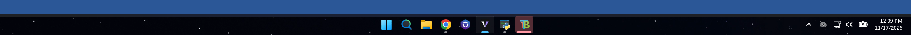
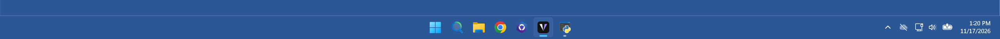

# TranslucentBarImproved (fork of TranslucentTB)

> This is a personal fork of [TranslucentTB](https://github.com/TranslucentTB/TranslucentTB).
> Everything below the line is the original README. Please report issues with the fork here, not upstream.

With a transparent taskbar, a maximized app ends above a strip of wallpaper, which rarely matches the app.
This fork adds **`match_window_color`**: while a window is maximized, the taskbar takes the color of the app's
background near the taskbar, with a thin divider line in a slightly lighter or darker shade.

| Before (clear taskbar, maximized blue app) | After (`match_window_color`) |
|---|---|
|  |  |

### How it behaves
- Samples a band up to 192 logical pixels inside the app, using a fixed 96 by 16 grid up to 10 times a second.
- Prefers a shared background in both side margins. This keeps a PDF viewer's surround steady as white pages
  scroll past the taskbar. If the margins differ, combines the area's average and dominant color.
- Mixed content stays opaque. Capture failures retain the current app's last sample, or use a neutral
  system-theme surface until the first capture succeeds.
- Keeps taskbar icons and clock readable: the color is darkened (dark system theme) or lightened (light theme)
  until the text reaches 3:1 contrast. A white app gives a `#949494` taskbar.
- `show_line: true` draws the divider in a shade of the matched color.
- Changes fade over 250 ms (ease-out); content changes also pass through a 350 ms time-based filter.
  Switching apps resets that filter. Matching fades from and back to the configured appearance when that
  is a solid color (`clear`, `opaque`); `normal`, `blur` and `acrylic` are switched to in one step.
- Rechecks window state on foreground changes and once a second to recover missed maximize/restore events.
  That check only repaints a taskbar whose appearance changed, plus one full repaint every 10 s as a safety net.
- Sampling pauses while a full-screen app (game, video) covers the taskbar, and the sampling timer does not
  run when no appearance uses `match_window_color` or rules.

### Settings
Add it to `maximized_window_appearance` in `settings.json` (tray icon → Advanced → Edit settings):

```json
"maximized_window_appearance": {
  "enabled": true,
  "accent": "clear",
  "color": "#00000000",
  "show_line": true,
  "match_window_color": true
}
```

### Building
GitHub Actions builds an unsigned x64 portable app on every push (`.github/workflows/build.yml`, artifact
`TranslucentTB-portable-x64`). Unzip it anywhere and run `TranslucentTB.exe`; `settings.json` lives next to it.
Windows 11 only in portable mode, and the Microsoft.UI.Xaml 2.8 and VCLibs frameworks must be installed
(installing official TranslucentTB once pulls them in).

Notes:
- Quit the official TranslucentTB first; only one can run at a time.
- Updating requires restarting Explorer once, because Explorer keeps the injected `ExplorerTAP.dll` loaded.
- The fork's injected component uses its own GUIDs, so it never mixes with the official one.

### Changes vs upstream
- `Common/util/colormatch.hpp`: color picking, readability and fade math (tests in `Tests/util/colormatch.cpp`).
- `TaskbarAttributeWorker`: sampling timer, matched color state, fade timer.
- `ExplorerTAP`: new `SetTaskbarBorderColor` call; new GUIDs, ready event and payload (TAP API v5).
- `TranslucentTB.vcxproj`: `CppWinRTGenerateWindowsMetadata=true` to fix MSB4006 (circular target) on VS 2026.
- `tools/livecheck/`: Python scripts used to verify builds on a real screen (`verify_live.py`, `fade_check.py`,
  `audit_matching.py`). The audit reproduces PDF page-edge changes, thin borders, mixed content and
  maximize/restore transitions, saves taskbar PNGs and JSON, and fails if the expected surface does not match.

---

# TranslucentTB

[](https://liberapay.com/TranslucentTB/)
[][Discord]
[](https://dev.azure.com/TranslucentTB/TranslucentTB/_build)
[](https://www.codefactor.io/repository/github/translucenttb/translucenttb/overview/develop)


A lightweight (uses a few MB of RAM and almost no CPU) utility that makes the Windows taskbar translucent/transparent on Windows 10 and Windows 11.

## Features

- Advanced **color picker** supporting alpha and live preview to change the taskbar's color.
- **Taskbar states** (choose one - color can be customized on every state except Normal):
  - **Normal**: Regular Windows style. (as if TranslucentTB was not running)
  - **Opaque**: Tinted taskbar, without transparency.
  - **Clear**: Tinted taskbar.
  - **Blur**: Will make the taskbar slightly blurred. Windows 10 and Windows 11 build 22000 only.
  - **Acrylic**: Will give the taskbar an appearance similar to Microsoft's Fluent Design guidelines.
- **Dynamic** modes (these can be used together and each of them provides a taskbar state and color you can customize):
  - **Visible window**: Will change the taskbar to a different appearance if a window is currently open on the desktop.
  - **Maximized window**: Will change the taskbar to a different appearance if a window is currently maximised.
  - **Start opened**: Will change the taskbar appearance when the start menu is opened.
  - **Search opened**: Will change the taskbar appearance when the search menu (previously Cortana) is open.
  - **Task View opened**: Will change the taskbar apperance when the Task View (previously Timeline) is open.
- On Windows 10, ability to **show or hide the Aero Peek button** depending on the currently active dynamic mode.
- On Windows 11, ability to **show or hide the taskbar line** depending on the currently active dynamic mode.
- Compatible with [RoundedTB](https://github.com/torchgm/RoundedTB)!
- Compatible with [ExplorerPatcher](https://github.com/valinet/ExplorerPatcher)!

## Screenshots

 

  

## Download

[](https://apps.microsoft.com/store/detail/9PF4KZ2VN4W9)

You can download the program for free from the [Microsoft Store](https://www.microsoft.com/store/apps/9PF4KZ2VN4W9) and take advantage of its features like background auto-updates.

Alternatively, you can download `TranslucentTB.appinstaller` [via the releases tab](https://github.com/TranslucentTB/TranslucentTB/releases) and open it to install the app.

A portable version of the app is also available [on GitHub releases](https://github.com/TranslucentTB/TranslucentTB/releases) as `TranslucentTB.zip`, but this version only works on Windows 11.

If you want to get the latest bleeding edge build, you can grab it over at the [Azure Pipelines page](https://dev.azure.com/sylve0n/TranslucentTB/_build?definitionId=4). Note that these builds may not work, or include features that are partially complete. Use at your own risk.

## Add to Startup

To add TranslucentTB to startup, check the "Open at boot" entry in the TranslucentTB tray icon's context menu. If you are having issues or the entry in the context menu is grayed out, try applying the following registry changes:
```reg
Windows Registry Editor Version 5.00

[HKEY_LOCAL_MACHINE\SOFTWARE\Microsoft\Windows\CurrentVersion\Policies\System]
"EnableFullTrustStartupTasks"=dword:00000002
"EnableUwpStartupTasks"=dword:00000002
"SupportFullTrustStartupTasks"=dword:00000001
"SupportUwpStartupTasks"=dword:00000001
```

Portable versions can be added to startup by creating a shortcut to the executable in `%AppData%\Microsoft\Windows\Start Menu\Programs\Startup`.

## Donations and contributions

[We have a Liberapay!](https://liberapay.com/TranslucentTB/) Don't hesitate to donate if you appreciate TranslucentTB and would like to support our work.

If you want to contribute to the source code, we have [a how-to contribute guide](CONTRIBUTING.md).

## Security

Some antiviruses are over eager, so they might flag this program as malicious. IT IS NOT! Over 10M users have downloaded this program safely. The source is open, you can [compile it yourself](CONTRIBUTING.md#building-from-source), and we welcome any and all security reviews.

## Thanks

TranslucentTB is a team effort! It is the result of the collective efforts of many people:

- [@ethanhs](https://github.com/ethanhs),
- [@sylveon](https://github.com/sylveon),
- [@MrAksel](https://github.com/MrAksel),
- [@denosawr](https://github.com/denosawr),
- and last but not least, all of [our contributors](https://github.com/TranslucentTB/TranslucentTB/graphs/contributors)!

Thanks to [@dAKirby309](https://github.com/dAKirby309) for making the icon! You can find more of his stuff on [his DeviantArt profile](https://dakirby309.deviantart.com/).

### License

This program is free (as in speech) software under the GPLv3. Please see [the license file](LICENSE.md) for more.

[Discord]: https://discord.gg/TranslucentTB
